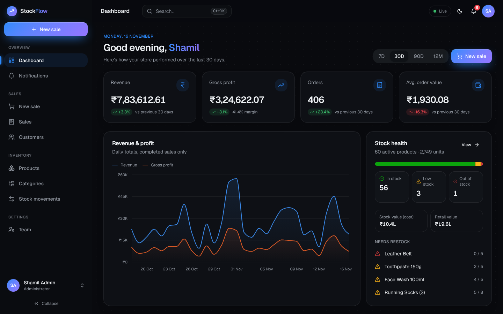
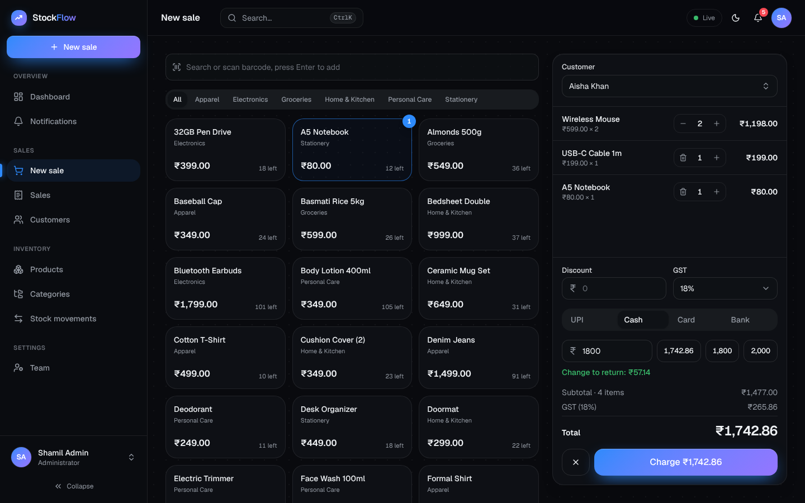
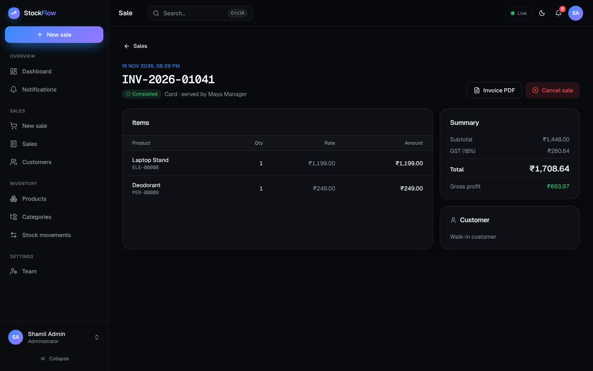
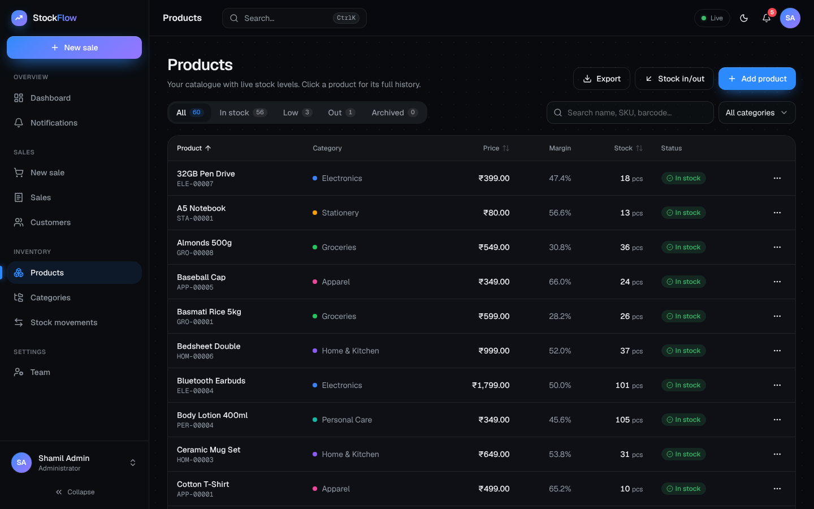
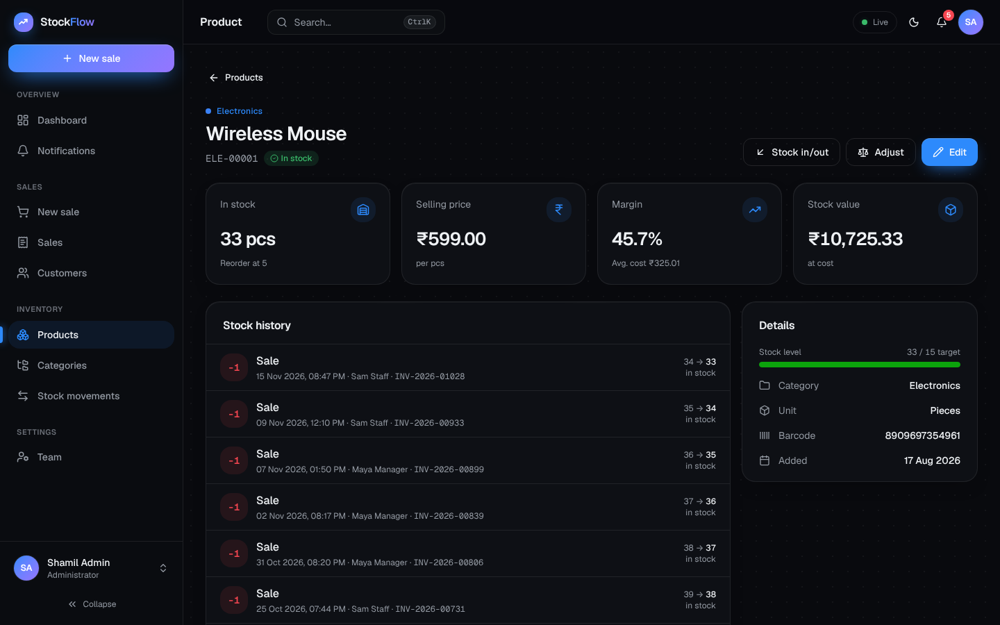
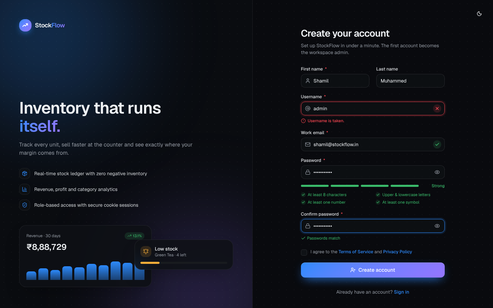
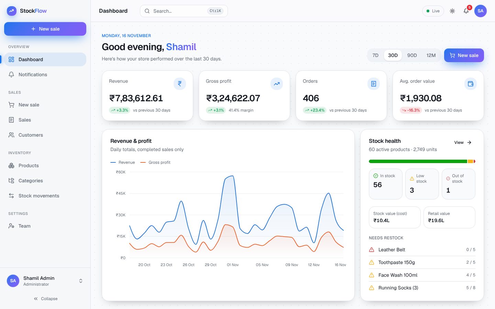
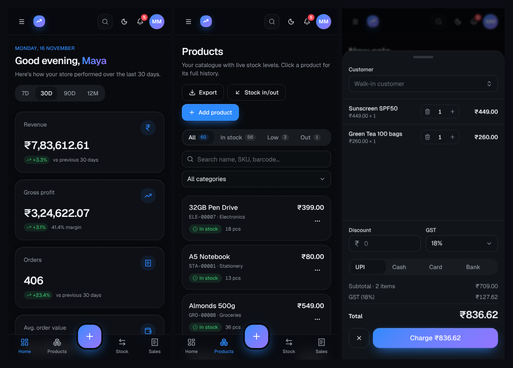

<div align="center">

# StockFlow

**Inventory, point-of-sale and analytics for small retail businesses.**

React 19 · TypeScript · Tailwind CSS v4 · TanStack Query · Jotai · Zod
Django 6 · Django REST Framework · PostgreSQL 16 · JWT in httpOnly cookies



</div>

---

## What it does

| | |
|---|---|
| **Point of sale** | Tap products or scan a barcode (Enter adds the item), pick a customer, apply discount & GST, take UPI / cash / card – the cash screen shows the change to return. One click prints a PDF tax invoice. |
| **Inventory you can trust** | Every unit in or out is written to an immutable stock ledger. Stock can never go negative: each change runs in a database transaction with a row lock, so two cashiers can't sell the last item twice. |
| **Products & categories** | Live stock status (in / low / out), reorder levels, weighted-average cost on every delivery, stock-take adjustments, archive instead of delete, CSV export. |
| **Dashboard** | Revenue & gross profit trend, period-over-period change, sales by category, top products, stock health and a "needs restock" list – for 7 days, 30 days, 90 days or 12 months. |
| **Low-stock alerts** | Managers are notified automatically when a product goes low or out of stock, and again when it's back. |
| **Roles** | **Admin** (everything + team), **Manager** (pricing, adjustments, cancellations, reports, profit) and **Staff** (sell, receive stock, customers – no cost or profit figures). Enforced on the API, mirrored in the UI. |
| **Secure auth** | Register → sign in with username *or* email, "remember me", password reset by email, change password (signs out other devices). Tokens live in httpOnly cookies, every write is CSRF-protected, sessions refresh silently. |
| **Works on phones** | Bottom tab bar, bottom-sheet dialogs, card lists, pull-to-refresh, infinite scroll and a mobile cart drawer. Dark & light themes. |

## Screenshots

| Point of sale | Sale detail |
|---|---|
|  |  |
| **Products** | **Product history** |
|  |  |
| **Register (live checks)** | **Light theme** |
|  |  |



## Architecture

```
StockFlow/
├── backend/                      Django 6 + DRF  (API at /api/v1, docs at /api/docs)
│   ├── config/settings/          base · dev · prod · test   (secrets from .env)
│   └── apps/
│       ├── core/                 pagination, unified errors, role permissions, seed_demo
│       ├── accounts/             custom User + roles, cookie JWT + CSRF auth
│       ├── catalog/              categories, products, CSV export
│       ├── inventory/            immutable stock ledger + atomic stock services
│       ├── sales/                customers, multi-item sales, gap-free invoices, PDF
│       ├── notifications/        low / out-of-stock and team alerts
│       └── analytics/            dashboard aggregations, sales report CSV
└── frontend/                     React 19 + Vite
    └── src/
        ├── app/                  router (lazy routes), guards, providers
        ├── components/
        │   ├── ui/               Radix-based design-system primitives
        │   ├── feedback/         spinner, skeleton, progress, pulse, pull-to-refresh, infinite scroll…
        │   ├── data/             data table, pagination, search, KPI cards
        │   ├── layout/           sidebar, top bar, mobile nav, ⌘K command palette
        │   └── shared/           form field, password strength, dialogs, badges
        ├── features/             auth · dashboard · catalog · inventory · sales · notifications · team · profile
        ├── lib/                  API client (CSRF + refresh queue), errors, query client, formatting
        └── store/                Jotai atoms (UI, preferences, POS cart)
```

**Design decisions worth knowing**

- **Business logic lives in services, not views.** `inventory.services` is the only code that changes `Product.quantity`; sales and adjustments call it.
- **Money is exact.** Decimals end-to-end, sent as strings, formatted only at the edge (`₹8,88,729.54`).
- **One error shape.** Every API error is `{ "error": { "code", "message", "details" } }`, so forms map field errors automatically.
- **Responses are validated.** Every API response is parsed with Zod; a backend contract change fails loudly instead of rendering `undefined`.
- **State has one home each.** Server data → TanStack Query; session & theme → Context; UI and the POS cart → Jotai; filters → the URL.
- **Charts follow data-viz rules.** One axis, colour-blind-validated series colours, reserved status colours always paired with icon + label.

## Getting started

**Requirements:** Python 3.12+, Node 22+, PostgreSQL 16 (or Docker).

```bash
# 1. Database (skip if you run Postgres natively)
docker compose up -d

# 2. Backend
cd backend
python -m venv venv && source venv/bin/activate
pip install -r requirements/dev.txt
cp .env.example .env            # then set DJANGO_SECRET_KEY
python manage.py migrate
python manage.py seed_demo      # optional: 60 products, 25 customers, ~1,000 sales over 90 days
python manage.py runserver      # http://127.0.0.1:8000/api/docs/

# 3. Frontend (new terminal)
cd frontend
npm ci
npm run dev                     # http://localhost:5173
```

Open **http://localhost:5173**. The Vite dev server proxies `/api` to Django, so the auth cookies are same-origin. The first account you register becomes the workspace **Admin**.

**Demo accounts** (after `seed_demo`, password `Demo@12345`): `admin@stockflow.dev`, `manager@stockflow.dev`, `staff@stockflow.dev`.

## Quality

| | Command |
|---|---|
| Backend tests (pytest, PostgreSQL) | `cd backend && pytest` |
| Backend lint & format | `ruff check . && ruff format --check .` |
| OpenAPI schema validation | `python manage.py spectacular --validate --fail-on-warn --file /tmp/schema.yml` |
| Frontend type-check (strict) | `cd frontend && npm run typecheck` |
| Frontend lint & tests | `npm run lint && npm test` |
| Production build | `npm run build` |

GitHub Actions runs all of the above on every push (`.github/workflows/ci.yml`).

## API overview

| Area | Endpoints |
|---|---|
| Auth | `csrf/` `register/` `login/` `refresh/` `logout/` `me/` `availability/` `password/reset/` `password/reset/confirm/` `password/change/` |
| Catalog | `categories/` `products/` `products/{id}/adjust-stock/` `products/export/` `products/options/` `products/summary/` |
| Inventory | `stock-movements/` (create & read only) |
| Sales | `sales/` `sales/{id}/cancel/` `sales/{id}/invoice/` `sales/summary/` `customers/` `customers/{id}/sales/` |
| Insights | `analytics/dashboard/?range=30d` `analytics/reports/sales/` `notifications/` |
| Team | `users/` `users/stats/` (admin) |

Full interactive docs: **http://127.0.0.1:8000/api/docs/**

---

Built by **Shamil** · Kochi, Kerala
